# Allenamento

App web **mobile-first** (Streamlit, tutta in italiano) per seguire il piano di allenamento in 3 sedute
**A / B / C** e registrare, serie per serie, **kg e ripetizioni**, più note, dolore alla spalla, peso corporeo
e giubbotto della seduta C. Pensata per un telefono Android con Chrome, con il tema scuro e i tasti grandi.

Stile grafico **"Studio"**: sfondo blu notte, card morbide, accento azzurro, font Outfit e icone a tratto
sottile (nessuna emoji nell'interfaccia).

L'obiettivo principale è **non perdere mai i dati**, anche quando in palestra la rete va e viene:

1. ogni tap su **Fatta** viene scritto **subito nel telefono** (localStorage del browser);
2. poi parte verso il server, che lo salva su **GitHub** in un **repo dati privato**, separato dal codice;
3. finché GitHub non conferma, il chip della serie mostra un orologio al posto della spunta e la coda viene
   reinviata da sola quando torna la rete (anche dopo una riconnessione o un refresh della pagina).

> Gli screenshot sono stati fatti in modalità locale, con viewport 412×915 (telefono Android) e **dati dimostrativi**.

| Home | Seduta (superset) | Timer di recupero |
|---|---|---|
| 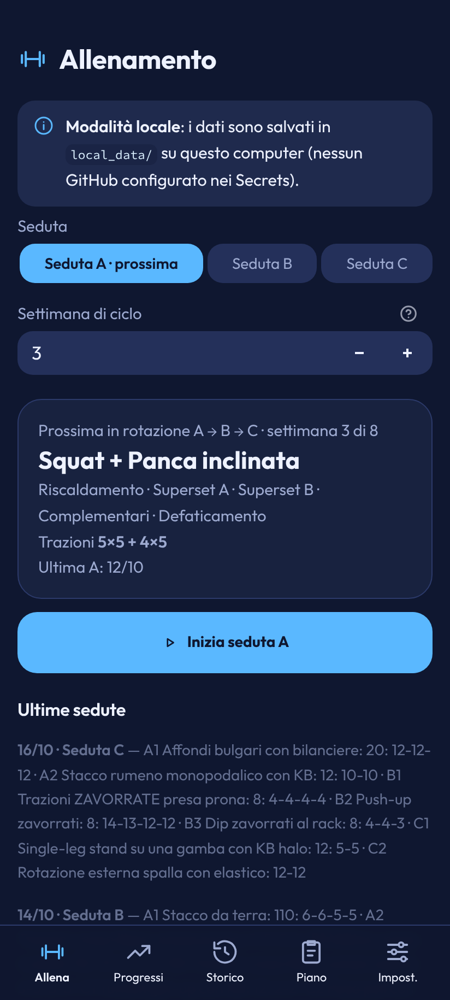 | 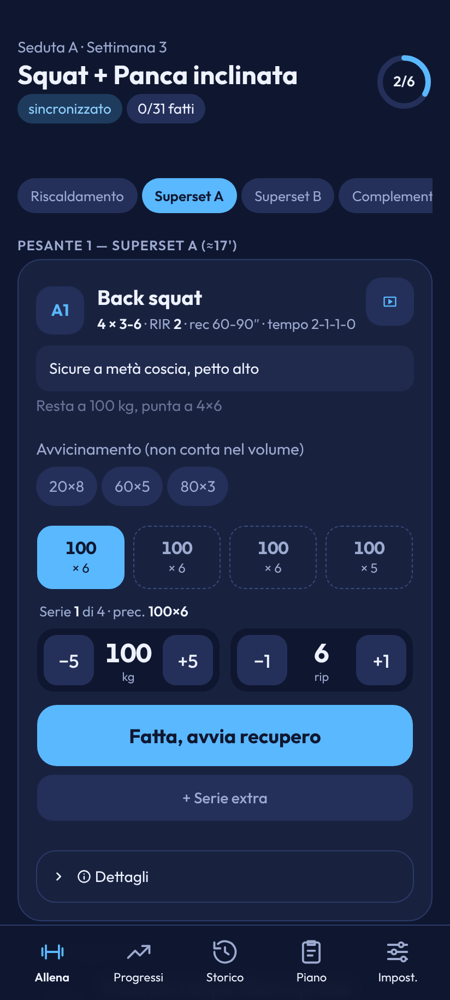 | 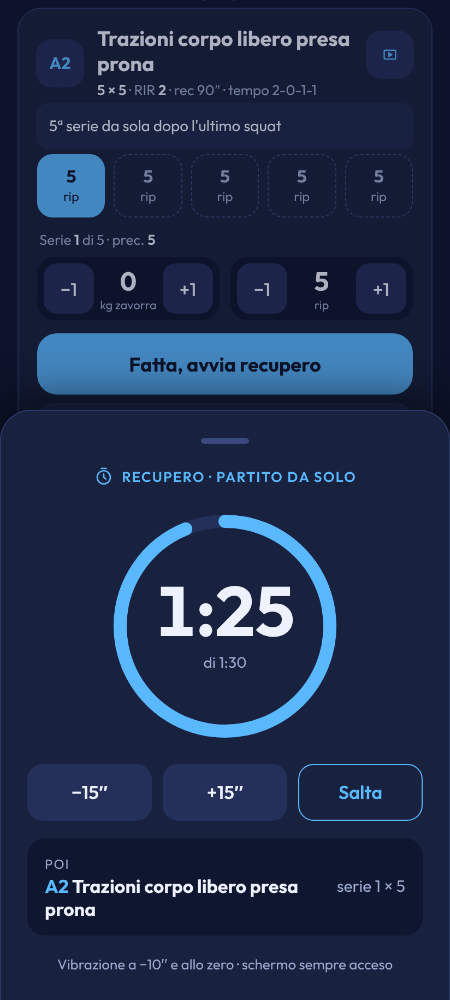 |
| **Timer ridotto a barra** | **Riscaldamento EMOM** | **Offline: serie in coda** |
| 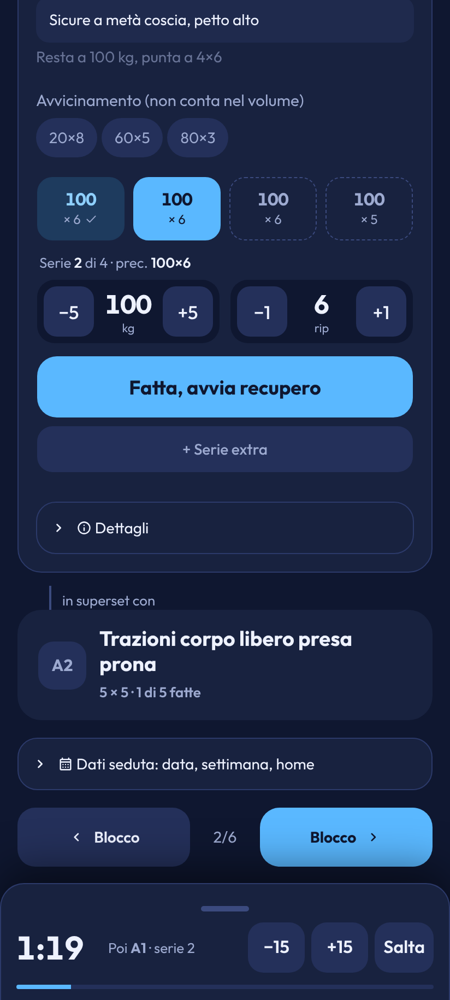 | 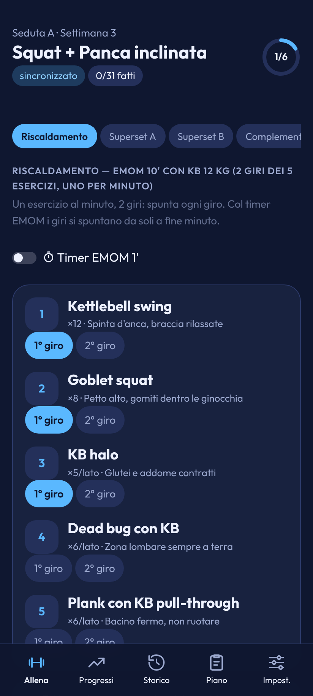 | 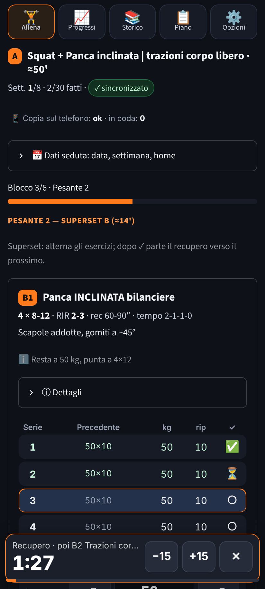 |
| **Fine seduta** | **Storico** | **Progressi (e1RM)** |
| 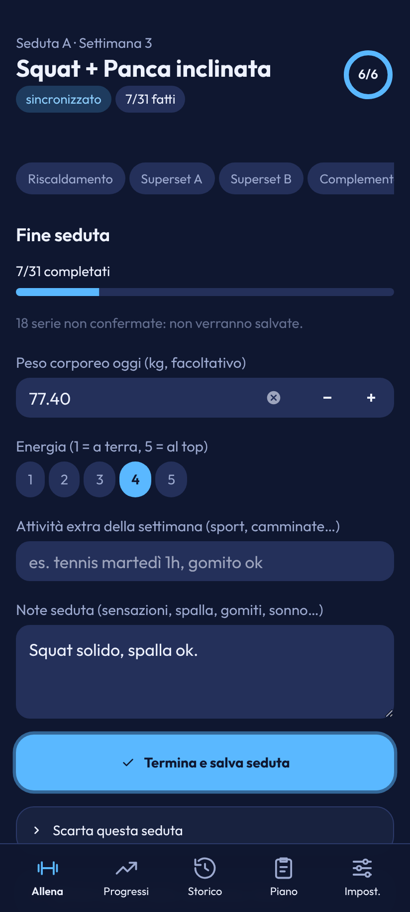 | 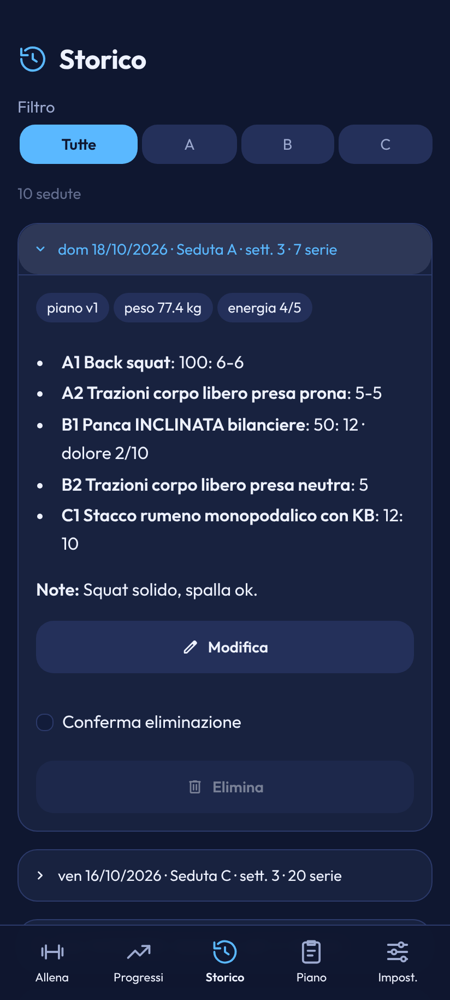 | 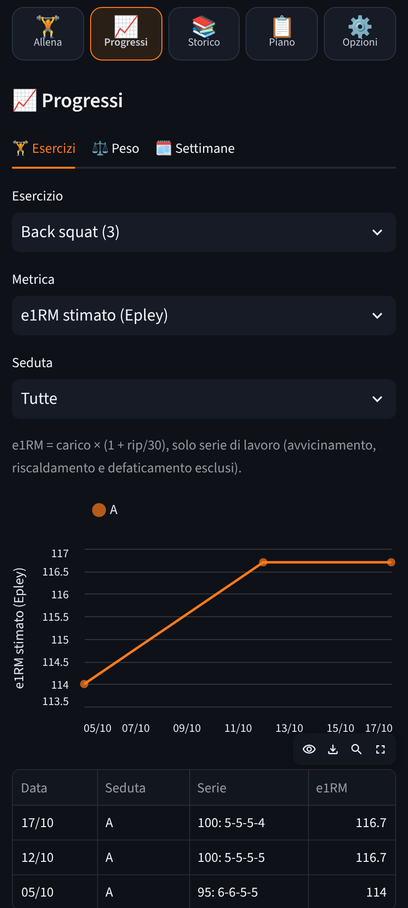 |
| **Peso corporeo** | **Piano e regole** | **Login** |
| 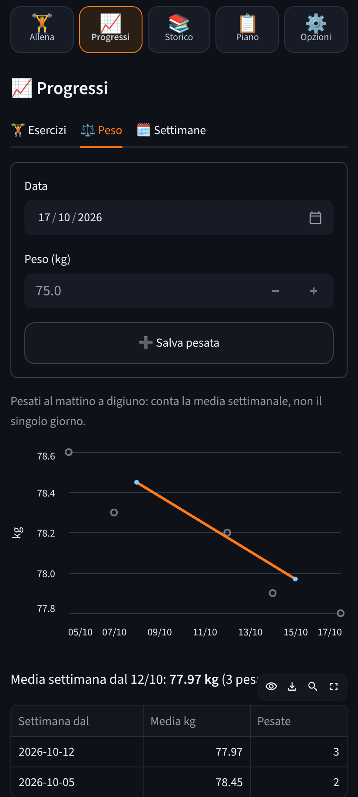 | 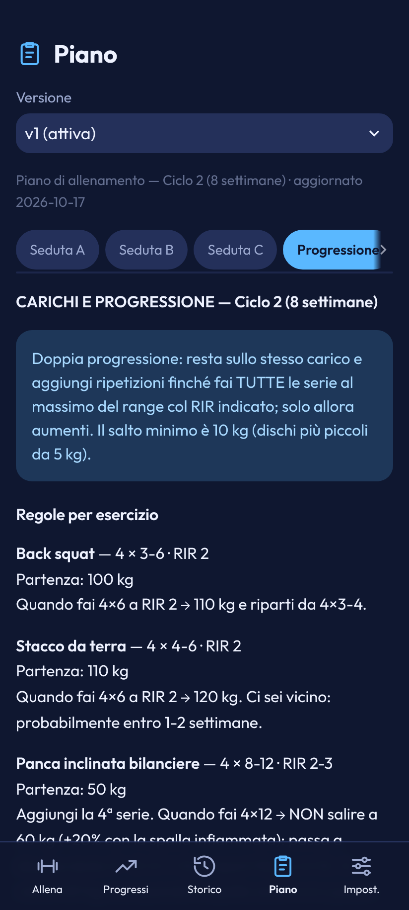 | 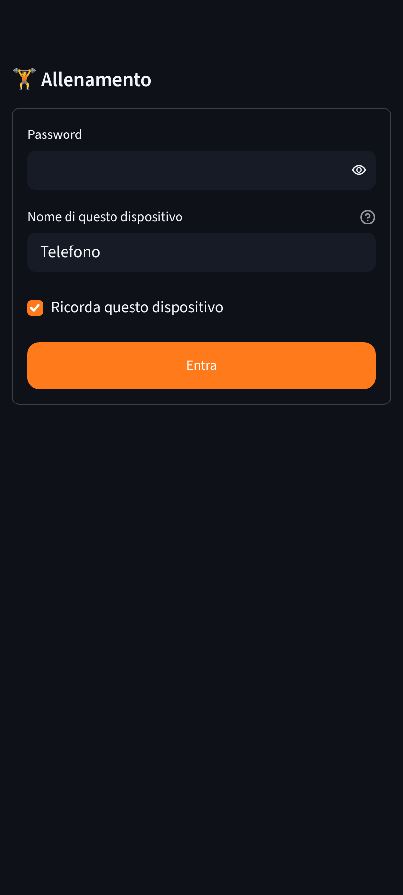 |
| **Dispositivi autorizzati** | **Blocco giubbotto (seduta C)** | **Secondo dispositivo sulla stessa seduta** |
| 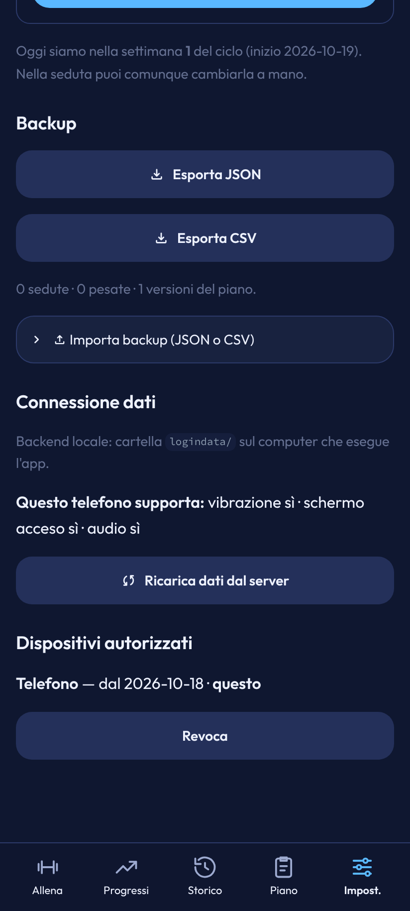 | 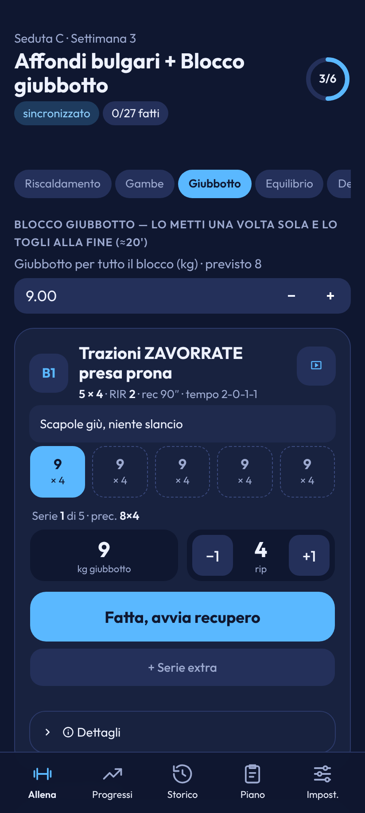 | 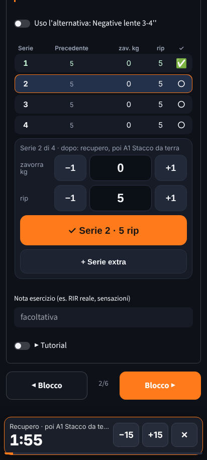 |

## Cosa fa

**Allenamento**
- Suggerisce la prossima seduta nella rotazione A → B → C e la **settimana di ciclo** (calcolata dalla data di
  inizio ciclo, modificabile a mano nella seduta se hai saltato sedute o fatto uno scarico).
- La seduta si vede **un blocco alla volta**: in alto "Seduta A · Settimana N", il titolo e l'anello 2/6;
  sotto, le **linguette dei blocchi** (riscaldamento, superset A, …) da toccare per saltare a un blocco, oltre
  ai tasti **Blocco** in fondo.
- Nei superset e nei circuiti la **card dell'esercizio a cui tocca** è aperta (tessera A1, nome, prescrizione,
  tasto video, indicazione chiave); sotto, "in superset con" e la card compatta del partner (toccala per aprirla).
  Dopo ogni serie la card passa da sola all'altro esercizio.
- Le serie sono una griglia di **chip** (fatta / attuale / da fare), precompilate con i valori dell'ultima volta
  della **stessa seduta** (A con A) e della stessa serie; la prima volta con il **minimo** del range di ripetizioni.
  Registrare una serie è **un tap su "Fatta, avvia recupero"**; per correggere ci sono gli stepper affiancati
  **±kg** (5 kg per il bilanciere, 4 kg per le kettlebell, 1 kg per giubbotto/zavorra, oppure il campo `kgStep`
  del piano; i tasti ± portano al multiplo del passo, il carico iniziale del piano e i suggerimenti vengono
  arrotondati al passo ma mai sotto l'ultimo carico, mentre i valori dell'ultima seduta si ripropongono come sono,
  anche 102,5) e **±1 rip** (o si scrive il numero).
  Toccando un chip si corregge quella serie. Si può aggiungere una **serie extra** (es. la 5ª trazione) o toglierne una.
- **Timer di recupero** che parte da solo dopo "Fatta" (durata presa dal piano, es. "60-90''" → 90 s): pannello
  che sale dal basso con l'anello che si svuota, −15″ / +15″ / Salta e il riquadro "Poi: A2 Trazioni · serie 3 × 5".
  Vibrazione a −10″ e allo zero, beep e lampeggio a fine recupero, schermo acceso. Il pannello non blocca la
  pagina: la pagina scorre da sola in modo che il tasto "Fatta" dell'esercizio successivo (il partner del superset)
  resti visibile sopra il pannello, quindi la serie dopo si segna con un tocco anche col timer aperto; se lo
  spazio non basta il pannello parte ridotto. Trascinandolo in basso (o toccando la maniglia) si riduce a una barra. Si basa
  sull'orario di fine salvato nel telefono, quindi sopravvive ai rerun e ai refresh.
- **Riscaldamento EMOM**: per ogni esercizio una spunta per giro (2 giri × 5); col timer a intervalli
  di 1' (facoltativo) i giri si spuntano da soli a fine minuto.
- Serie di **avvicinamento** del bilanciere (vuoto×8, 60×5, 80×3) come spunte separate: non contano nel volume né nei record.
- Sotto ogni esercizio solo la **prescrizione compatta** (es. "4 × 3-6 · RIR 2 · rec 60-90″ · tempo 2-1-1-0") e
  l'**indicazione chiave** (`cue` del piano); note complete, carico e alternativa in **Dettagli** (chiuso) e
  nella pagina Piano. Nota libera per esercizio (es. RIR reale) e note di seduta.
- **Alternativa** selezionabile (es. push-up al posto della panca): il log la segna con `usedAlternative`
  e non la mescola con i record dell'esercizio principale.
- **Dolore spalla sinistra 0-10** sugli esercizi con controllo dolore (avviso se ≥ 4).
- **Giubbotto** unico per la seduta C (precompilato dalla tabella trazioni della settimana) usato da
  trazioni zavorrate, push-up e dip.
- **Tutorial video** dentro l'esercizio, caricato solo quando tocchi il tasto video della card e avviato da solo (senza audio,
  come richiede Chrome Android per l'autoplay; l'audio si attiva dal player), con link "Apri su YouTube" e ricerca di riserva.
- **Suggerimento di progressione** dalle regole del piano (sempre un suggerimento, mai automatico) e avviso
  se un esercizio peggiora **2 sedute di fila** (stesso esercizio, stessa seduta, solo serie di lavoro).
- A fine seduta: peso corporeo, energia 1-5, tennis/attività extra, note → **Termina e salva**.

**Progressi**: grafici per esercizio (e1RM di Epley solo per esercizi con bilanciere in kg e unità "rip";
per corpo libero/zavorrati e unità come rip/lato, metri, secondi si confrontano le ripetizioni a parità di
carico), record personali, peso corporeo con media settimanale, tabella di monitoraggio per settimana.

**Storico**: elenco sedute con dettaglio, modifica (data, serie, note) ed eliminazione con conferma.

**Piano**: vista completa con note, alternative, video, regole di progressione, tabella trazioni per
settimana. **Modifica** per esercizio (modulo) o JSON completo validato: ogni modifica crea una **nuova
versione** del piano (`plans/plan_vN.json`); le sedute salvate tengono la `planVersion` con cui sono state fatte.

**Impostazioni**: data di inizio ciclo, beep/vibrazione/schermo acceso, **export JSON e CSV**, import,
stato della connessione GitHub.

## Come sono salvati i dati

Il **codice** sta in un repo pubblico (questo); i **dati** in un repo GitHub **privato e separato**
(es. `allenamento-dati`). L'app scrive solo lì, sul branch indicato da `DATA_BRANCH` (di default `main`),
quindi i salvataggi non toccano il repo del codice e non fanno ripartire l'app. Se `GITHUB_REPO` punta per
errore a un repo **pubblico** (per esempio quello del codice), l'app se ne accorge e **si rifiuta di scrivere**.

```
allenamento-dati (repo privato, branch main)
├── settings.json                 impostazioni (inizio ciclo, versione piano attiva, dispositivi autorizzati)
├── bodyweight.json               pesate
├── plans/plan_v1.json            piano (v1 copiato da data/plan_v1.json del codice al primo avvio)
├── drafts/current.json           seduta in corso, salvata a ogni serie
└── logs/2026-10-21_A_183012.json una seduta per file
```

Ogni file è versionato da git: la cronologia del repo dati è già un backup. Va bene anche un repo dati appena
creato e vuoto: la prima scrittura crea il primo commit.
Prima di ogni scrittura della bozza l'app rilegge la versione sul server e **unisce serie per serie**
(vince il tap più recente); se nel frattempo lo SHA cambia ancora, rilegge e riunisce. La coda sul telefono
si svuota solo dopo la conferma della scrittura unita. Ogni seduta salvata ha un id fisso derivato dalla
bozza: se "Termina e salva" viene ripetuto (es. risposta persa per la rete) non nasce un secondo file, e una
bozza già salvata come seduta viene scartata automaticamente.

Senza secrets GitHub l'app funziona in **modalità locale** (cartella `./local_data`, banner "Modalità locale"):
utile per provarla sul computer.

## Deploy passo-passo (si può fare tutto dallo smartphone)

Tutti i passi si fanno dal browser del telefono (Chrome): niente computer, niente terminale.
Se una pagina di GitHub o Streamlit è scomoda, nel menu ⋮ di Chrome attiva **"Sito desktop"**.

### 1. I due repo GitHub
- **Codice (pubblico)**: `marcoveninata93-eng/allenamento-app`, già pronto sul branch `main` con tutto il
  codice. Non devi caricare niente.
- **Dati (privato)**: `marcoveninata93-eng/allenamento-dati`. Crealo da GitHub → **+** → **New repository**,
  visibilità **Private**, con "Add a README file" (così esiste già il branch `main`). Va bene anche vuoto.

### 2. Token GitHub "fine-grained" (solo il repo dati, solo Contents)
1. GitHub → foto profilo → **Settings** → **Developer settings** → **Personal access tokens** →
   **Fine-grained tokens** → **Generate new token**.
2. *Token name*: `allenamento-dati`; *Expiration*: per esempio 1 anno (segnati la scadenza).
3. *Repository access*: **Only select repositories** → **solo** `marcoveninata93-eng/allenamento-dati`
   (non il repo del codice).
4. *Permissions* → *Repository permissions* → **Contents: Read and write** (GitHub aggiunge da solo
   *Metadata: Read-only*). **Nient'altro.**
5. **Generate token** e copia il valore `github_pat_…` (si vede una volta sola).

### 3. Streamlit Community Cloud
1. Vai su <https://share.streamlit.io> ed entra con GitHub.
2. **Create app** → deploy da un repository GitHub esistente, con questi valori:
   - **Repository**: `marcoveninata93-eng/allenamento-app` (il repo del codice)
   - **Branch**: `main`
   - **Main file path**: `app.py`
   - *App URL*: a piacere
3. **Advanced settings** → *Python version* **3.12** (o più recente) → **Secrets**, incolla (formato TOML):

   ```toml
   GITHUB_TOKEN = "github_pat_xxxxxxxxxxxxxxxx"
   GITHUB_REPO = "marcoveninata93-eng/allenamento-dati"
   DATA_BRANCH = "main"
   APP_PASSWORD = "una-password-lunga-che-ricordi"
   ```

   `GITHUB_REPO` è il repo **dati**, non quello del codice. `APP_PASSWORD` è **obbligatoria** quando c'è
   GitHub: senza, l'app si rifiuta di leggere e scrivere i dati.
4. **Deploy**. Al primo avvio l'app scrive nel repo dati `settings.json` e `plans/plan_v1.json`.

I secrets si cambiano dopo da *⋮ → Settings → Secrets* (l'app si riavvia da sola).

**Visibilità**: il repo del codice è pubblico, quindi l'app su Community Cloud è raggiungibile da chiunque
abbia l'indirizzo. A proteggere i dati ci pensano `APP_PASSWORD` + i dispositivi autorizzati, e il fatto che
i dati stanno in un repo privato leggibile solo col token (che vive nei Secrets, mai nel codice).

Se l'app non viene usata per qualche giorno Streamlit la mette in pausa: basta aprirla e premere il
pulsante per risvegliarla. I dati sono su GitHub, non si perdono.

### 4. Sul telefono (Android / Chrome): login e icona nella schermata Home
1. Apri l'indirizzo dell'app in Chrome, scrivi la password, dai un nome al dispositivo (es. "Telefono")
   e lascia spuntato **"Ricorda questo dispositivo"**.
2. L'app genera un **token casuale per questo dispositivo**: nel browser resta il token, nel file
   `settings.json` del repo dati solo la sua impronta (hash). Nell'indirizzo non c'è nessuna chiave.
3. Menu **⋮** → **Aggiungi a schermata Home** (o **Installa app**) → **Aggiungi**. L'icona (e il
   ricaricamento di qualsiasi pagina) entra senza chiedere la password finché il dispositivo è autorizzato.
4. In **Impostazioni → Dispositivi autorizzati** vedi l'elenco e puoi **revocare** un dispositivo
   (es. telefono perso). Cancellare i dati di Chrome fa dimenticare il dispositivo: basta rifare il login.
5. Dopo **5 password errate** il login si blocca per 10 minuti.
6. Nelle Impostazioni lascia attivi beep, vibrazione e "schermo acceso".

## Uso in palestra (in breve)
1. **Inizia seduta** (o **Riprendi** se ne avevi una in corso: la bozza sopravvive a refresh, sospensione
   dell'app e cambio di rete).
2. Per ogni serie: controlla kg/rip precompilati, correggi con ± se serve, **Fatta, avvia recupero**. Parte il recupero.
3. **Blocco** (o la linguetta del blocco) per passare al successivo. In cima vedi "sincronizzato" o "N serie in attesa".
4. Ultimo blocco: peso, energia, note → **Termina e salva seduta**.

## Modificare il piano
- Dall'app: **Piano → Modifica** → scegli seduta ed esercizio, cambia serie/ripetizioni/tempo/
  recupero/carico/note/alternativa/video → **Salva come nuova versione** (puoi renderla attiva subito).
- Per modifiche strutturali (nuovi esercizi o blocchi): modalità **JSON completo**, validato prima del
  salvataggio (id esercizi stabili: minuscole, numeri e trattini; un id uguale in sedute diverse = stesso
  esercizio per grafici e precompilazione).
- `data/plan_v1.json` nel repo del codice serve solo al primo avvio; le versioni successive vivono nel repo dati.
  Ai piani salvati prima dei campi `cue` (indicazione chiave) e `kgStep` (passo ±kg) l'app aggiunge in lettura
  i valori di `data/plan_v1.json` per esercizio, senza toccare le altre modifiche.
- I video sono in `data/videos.json` (per `exerciseId` e per testo dell'alternativa); un link diretto
  inserito nel piano (campo "video") ha la precedenza.

## Backup e ripristino
- **Impostazioni → Esporta JSON**: backup completo (sedute, piani, pesate, impostazioni, bozza).
- **Esporta CSV**: una riga per serie, comodo per Excel/Fogli Google.
- **Importa**: accetta il JSON di backup o il CSV esportato; di default non sovrascrive sedute esistenti.
- In più, il repo dati su GitHub conserva la cronologia di ogni file.

## Sviluppo locale

```bash
pip install -r requirements-dev.txt
streamlit run app.py          # modalità locale: dati in ./local_data
pytest -q                     # test di logica, piano e storage (GitHub simulato)
```

Per provare il backend GitHub in locale crea `.streamlit/secrets.toml` con gli stessi valori dei Secrets
(il file è in `.gitignore`).

### Struttura

```
app.py                  configurazione, login, navigazione
views/                  pagine: allenamento, progressi, storico, piano, impostazioni
lib/plan.py             piano: lettura, validazione, tabella trazioni, versioni, video (logica pura)
lib/logic.py            settimana di ciclo, rotazione, bozza ed eventi delle serie, e1RM/PR,
                        peggioramenti, suggerimenti, peso, CSV (logica pura)
lib/storage.py          Storage astratto + LocalStorage + GitHubStorage (Contents API) + DataStore
lib/auth.py             token per dispositivo, verifica, revoca, limite ai tentativi (logica pura)
lib/services.py         secrets, scelta backend, login, cache (st.cache_data) e invalidazione
lib/ui.py               CSS mobile e componenti grafici
lib/timer.py            componenti browser: registro serie, ponte bozza/telefono, token dispositivo, timer EMOM
lib/components/web/     HTML/JS del componente (outbox localStorage, timer di recupero)
data/plan_v1.json       piano iniziale · data/videos.json tutorial
tests/                  pytest
```

Le pagine stanno in `views/` e non in `pages/`: con `st.navigation` una cartella `pages/` attiverebbe anche la
vecchia navigazione automatica di Streamlit (pagine aperte senza login né CSS).

## Limiti noti
- **Vibrazione, beep e schermo acceso** usano le API del browser (`navigator.vibrate`, Web Audio, Wake Lock):
  in Chromium headless risultano disponibili, ma su un telefono vero vanno provati. Chrome può bloccarle se
  non c'è stato un tocco recente (il tap su "Fatta" lo è); a telefono bloccato il timer non suona (al ritorno mostra
  il tempo giusto e lampeggia). Il timer EMOM richiede un tap su "Avvia".
- I video YouTube si caricano solo con rete; i link vengono da una ricerca e non sono stati verificati uno a uno.
- La coda sul telefono vive nel browser: se cancelli i dati di Chrome prima che la serie sia sincronizzata
  (orologio sul chip), quella serie si perde.
- Le modifiche ai campi di testo (note, peso) si salvano quando esci dal campo; non passano dalla coda
  del telefono come le serie.
- Pensata per un solo utente. Con due telefoni o due schede sulla stessa seduta ogni salvataggio rilegge la
  bozza dal server e **unisce le serie** (vince il tap più recente sulla stessa serie): nessuna serie si perde.
  Per note, dolore, alternativa vince l'ultima modifica dell'esercizio; per i campi di fine seduta (peso,
  energia, note) vince il dispositivo che salva per ultimo. Una nuova seduta non può partire se sul server
  ce n'è già una in corso.
- La Contents API elenca al massimo 1000 file per cartella (circa 6 anni di sedute).
- Grafica: chip delle serie, stepper e pannello del timer sono HTML del componente e seguono i mockup "Studio";
  il resto è fatto di widget Streamlit con CSS, quindi alcune misure (spaziature, testo delle linguette, icone
  Material dei pulsanti al posto delle icone "Linea") differiscono un po'. Le icone "Linea" della barra in basso
  sono maschere CSS sui link di Streamlit.
